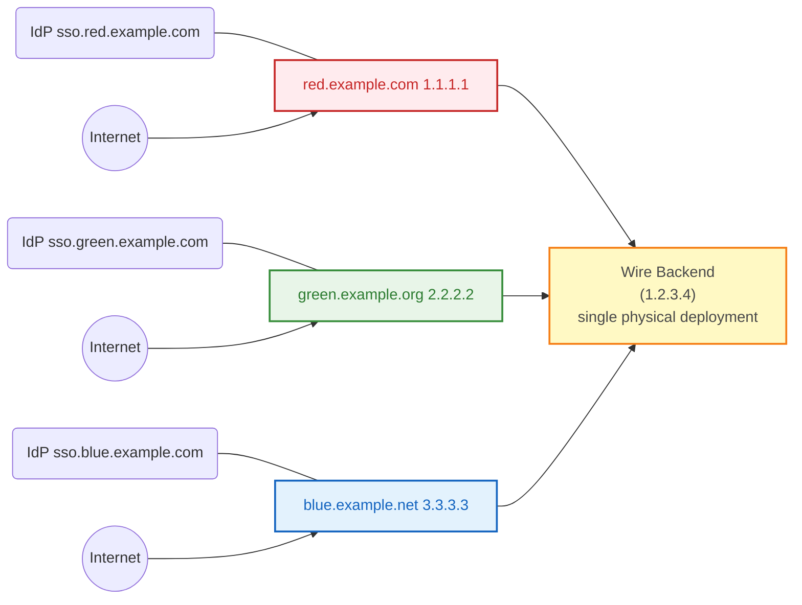

# How to configure a Wire deployment for Multi-SSO

## What is a Multi-SSO setup?



## Requirements

- A Wire Server backend at [v5.38](https://github.com/wireapp/wire-server/releases#release-2026-10-26) or later.
- A working [multi-ingress deployment](https://docs.wire.com/latest/how-to/install/multi-ingress.html).
- ldap-scim-bridge, if users are provisioned from LDAP. See [SCIM and LDAP provisioning](https://docs.wire.com/latest/understand/single-sign-on/understand/main.html#user-provisioning-scimldap).
- Multiple SAML identity providers.
- Credentials for a team administrator.

## Instructions

A multi-SSO configuration requires a cluster that is already configured for multi-ingress. For the base setup, use [the multi-ingress installation guide](https://docs.wire.com/latest/how-to/install/multi-ingress.html).

The configuration consists of four main steps:

1. **Enable multi-SSO:** Configure Wire Server, the Webapp, and Team Settings.
2. **Prepare IdP provisioning:** Configure the tools that manage IdPs across teams and domains.
3. **Register the SAML SPs:** Register each team-and-domain Service Provider entity ID with the corresponding IdP.
4. **Provision users:** Configure auto-provisioning or provision users with ldap-scim-bridge.

### 1. Enable Multi-SSO

Configure the following components:

- Wire Server Spar configuration
- Webapp environment variables
- Team Settings environment variables

#### Spar

In a multi-ingress deployment, Spar must act as a separate SAML Service Provider for each domain. Replace the single-domain SAML settings with:

- `spar.config.domainConfigs`
- `spar.config.idpCertFingerprintAllowlist`
- `spar.config.enableIdPByEmailDiscovery`

For the complete configuration reference, see [Spar in the multi-ingress guide](https://docs.wire.com/latest/how-to/install/multi-ingress.html#spar).

#### Galley

If users are provisioned through SCIM, you can disable the `validateSAMLemails` feature in Galley. This setting applies to email addresses supplied by both SCIM and SAML. When disabled, externally managed email addresses are auto-activated instead of requiring ownership verification.

```yaml
galley:
  config:
    settings:
      featureFlags:
        validateSAMLemails:
          defaults:
            status: disabled
```

For personal users and team users managed through Team Settings, email verification is always required.

#### Brig

To prevent public personal-user and team creation through the backend, set:

```yaml
brig:
  config:
    optSettings:
      setRestrictUserCreation: true
```

This setting does not block SCIM provisioning or team invitations.

#### Webapp

Disable public account registration:

```yaml
envVars:
  FEATURE_ENABLE_ACCOUNT_REGISTRATION: "false"
```

This disables the registration UI. It does not replace the backend restriction in Brig.

Enable SSO and dynamic hostname resolution:

```yaml
envVars:
  FEATURE_ENABLE_SSO: "true"
  ENABLE_DYNAMIC_HOSTNAME: "true"
  FEATURE_ENABLE_FEDERATION: "false"
```

Configure the multi-ingress backend URLs:

```yaml
config:
  externalUrls:
    backendRest: "nginz-https.[[hostname]]"
    backendWebsocket: "nginz-ssl.[[hostname]]"
    appHost: "webapp.[[hostname]]"
```

For the complete Webapp environment variable reference, see [wire-webapp `.env.defaults`](https://github.com/wireapp/wire-web-config-wire/blob/master/wire-webapp/.env.defaults).

#### Team Settings

Disable public team creation and enable the SSO and domain configuration screens:

```yaml
envVars:
  FEATURE_ENABLE_NEW_TEAM: "false"
  FEATURE_ENABLE_DOMAIN_REGISTRATION: "true"
  FEATURE_ENABLE_SSO_CONFIGURATION: "true"
```

- `FEATURE_ENABLE_NEW_TEAM` hides the Team Settings team-registration UI. It does not prevent backend API registration.
- `FEATURE_ENABLE_DOMAIN_REGISTRATION` enables domain-to-IdP configuration.
- `FEATURE_ENABLE_SSO_CONFIGURATION` enables the SSO configuration UI. In a multi-ingress SSO deployment, IdPs are managed with the provisioner rather than through Team Settings.

For the complete Team Settings environment variable reference, see [Wire Team Settings environment variables](https://github.com/wireapp/wire-team-settings/blob/dev/ENVIRONMENT_VARIABLES.md).

### 2. Configure the IdP Provisioner

In a multi-ingress SSO deployment, users can authenticate through more than one domain. Each domain may have its own SAML IdP, and each team may be associated with more than one IdP configuration. Managing these mappings manually becomes difficult as the number of teams and domains increases.

Use `idp-provisioner.sh` to automate the IdP configuration for teams:

- Repository: https://github.com/wireapp/wire-scripts/tree/multi-ingress-idp-provisioning/multi-ingress-idp-provisioning
- Main script: `idp-provisioner.sh`
- Wrapper scripts: `domain-wrapper.sh` and `team-wrapper.sh`

The wrapper scripts call `idp-provisioner.sh` for multiple domains or teams.

> **CAUTION:** Team Settings can configure an IdP for a team, but it supports only one domain configuration in the current implementation. Use the provisioner for multi-domain teams.

#### Environment variables

The scripts can run from a laptop, a Wire administration host, or a Wire utility container.

Set the following variables:

- `NGINZ_HOST`: The Wire Nginx service URL. In a multi-ingress deployment, this usually starts with the initial domain.
- `CURL_INSECURE=true`: Enables certificate verification bypass for local test environments. Do not use this setting outside a controlled environment.
- `CURL_HOST_HEADER`: Routes an HTTP request to a specific Nginx ingress when the local endpoint does not use the target hostname.

For example, run the scripts from admin host:

```bash
kubectl port-forward svc/ingress-nginx-controller-controller 443:443
export NGINZ_HOST=https://localhost
export CURL_INSECURE=true
export CURL_HOST_HEADER=nginz-https.domain1.com
```

Additional environment variables may be required for a different deployment environment.

#### `idp-provisioner.sh`

The script provides two subcommands:

- `get`: Lists the IdPs configured for a team.
- `set`: Adds an IdP to a team.

For `get`, provide the team credentials:

```bash
./idp-provisioner get team-a team-a-password
```

For `set`, provide the team credentials, domain, and IdP metadata file:

```bash
./idp-provisioner set team-a team-a-password blueberry.domain.com blueberry.domain.com.xml
```

### 3. Register the SAML SPs

In a single-domain deployment, Spar uses one SAML Service Provider identity URL:

```text
https://nginz-https.domain.com/sso/finalize-login
```

In a multi-ingress deployment, the SAML SP identity URL is specific to both the team and domain:

```text
https://nginz-https.domain1.com/sso/finalize-login/{team1-uuid}
https://nginz-https.domain2.com/sso/finalize-login/{team1-uuid}
https://nginz-https.domain1.com/sso/finalize-login/{team2-uuid}
https://nginz-https.domain2.com/sso/finalize-login/{team2-uuid}
```

> **Info:** Obtain SP metadata from `https://nginz-https.domain/sso/metadata/{team-uuid}`.

Before registering an IdP in Wire, coordinate with the IdP administrator. Register the corresponding SP entity URLs on the IdP side. The exact procedure depends on the IdP implementation and the organization's security policies.

For example:

- Keycloak can support automated client registration, but this service may be disabled for security reasons.
- AD FS can be configured with PowerShell, but requires administrative access to the IdP.

Treat SP registration as an out-of-band operation that is performed in parallel with the Wire Server IdP configuration.

For further information, see [Setting up SSO externally](https://docs.wire.com/latest/understand/single-sign-on/understand/main.html?h=ldap#setting-up-sso-externally).

### 4. Provision Users

Wire supports the following two SSO user provisioning methods:

#### Auto-provisioning

During SAML login, Wire Server creates a user account when no account exists for the authenticated identity. This behavior is team-scoped.

Creating a SCIM token for a team disables SAML auto-provisioning for that team. Delete all SCIM tokens for the team to re-enable SAML auto-provisioning.

#### SCIM provisioning

Wire Server exposes a SCIM API for creating, updating, and removing users. A team-scoped SCIM token authenticates the SCIM client.

In a multi-ingress deployment, define the SCIM URL with `spar.config.scimBaseUri`. It should point to the public Nginx ingress that serves the SCIM endpoint, for example:

```yaml
spar:
  config:
    scimBaseUri: https://nginz-https.domain1.com/scim/v2
```

If users are stored in LDAP or Active Directory, use ldap-scim-bridge to synchronize them to the Wire SCIM endpoint.

Before choosing ldap-scim-bridge for production, verify the bridge version and Wire Server version together. Confirm compatibility in a test environment before deploying to production.

For further information, see [Single sign-on and user provisioning](https://docs.wire.com/latest/understand/single-sign-on/understand/main.html).

### 5. Quick Tests

#### 1. Create a test team

Create a test team with [create_team.sh](https://github.com/wireapp/wire-scripts/blob/main/user-ops/create_team.sh):

```bash
./create_team.sh -d ssotest.local
```

The command creates a team administrator. Record the returned team ID, user ID, email address, and password for the following tests.

Example output:

```text
Successfully created a team admin user: 2d68ec54-dbab-4f62-820e-6ead2472ac99
Team: 0a500524-1be3-4c7a-90c5-79a852d1c02c
Email: teamadmin@ssotest.local
Password: PASSWORD
```

#### 2. Add the IdP certificate fingerprints

Get the SHA-1 fingerprint for each IdP signing certificate, and add every fingerprint to `spar.config.idpCertFingerprintAllowlist`:

```yaml
spar:
  config:
    scimBaseUri: https://nginz-https.green.example.org/scim/v2
    idpCertFingerprintAllowlist:
      - "AA:BB:CC:DD:EE:FF:00:11:22:33:44:55:66:77:88:99:AA:BB:CC:DD"
      - "F4:A2:73:D7:B7:2E:A6:66:E1:CB:81:E9:58:BC:1A:E9:CF:3C:95:C4"
```

#### 3. Add the IdP to the team

Use [idp-provisioner.sh](https://github.com/wireapp/wire-scripts/blob/multi-ingress-idp-provisioning/multi-ingress-idp-provisioning/idp-provisioner.sh) to add the IdP to the test team. Run these commands from the administration host:

```bash
d kubectl port-forward svc/ingress-nginx-controller-controller 443:443
```

Keep the port-forward running, then open another terminal and set the request variables:

```bash
export NGINZ_HOST=https://localhost
export CURL_HOST_HEADER=nginz-https.domain1.com
./provisioning-idp/idp-provisioner.sh set teamadmin@ssotest.local PASSWORD domain1.com ./provisioning-idp/idps/domain1.com.xml
```

> IMPORTANT: `idp-provisioner.sh set` will call 

Example output:

```text
Info: Authentication token is still valid. Using cached token.
Successfully created a new identity provider for domain 'https://localhost/v16'.
Handle  Domain name                 Issuer
IdP 1   nginz-https.domain1.com     https://keycloak.domain1.com/realms/master
```

`./provisioning-idp/idps/domain1.com.xml` is the IdP metadata file.

> **CAUTION:** If you are using `NGINZ_HOST=https://localhost`, set `CURL_HOST_HEADER` to the ingress domain that matches the domain passed to `idp-provisioner.sh`.

#### 4. Register the SAML SP in the IdP

After configuring the IdP in Wire, register the corresponding SAML Service Provider for the team and domain in the external IdP.

Use the following values:

- **SP metadata:** `https://nginz-https.domain1.com/sso/metadata/{team-uuid}`
- **SP entity ID:** `https://nginz-https.domain1.com/sso/finalize-login/{team-uuid}`

Registration details vary by IdP implementation and may require the administrator to upload the metadata or enter the entity ID manually.

#### 5. Verify login through Team Settings

After the SP is registered successfully in the IdP, test SSO authentication through Team Settings.

1. Open `https://teams.domain1.com` and log in with the team administrator credentials.
2. Open **Customization > Single Sign-On (SSO)** in Team Settings.
3. Identify the SSO login code that matches `domain1.com`.
4. In an incognito window or another browser profile, open `https://webapp.domain1.com`.
5. Enter the SSO login code and click **Login**.
6. Complete authentication at the IdP login page. After successful authentication, Wire redirects you back to the Webapp.
7. Confirm the requested handle and verify that you can open the app.

#### 6. Verify email-address login

After the test in step 5 succeeds, SSO discovery should resolve the IdP from the user's email address.

Open the Webapp, enter the user's email address, and click **Login**. Wire should redirect the browser directly to the correct IdP login page without requiring the SSO login code.

#### 7. Verify login through another domain

Log in with the same user through another configured domain and IdP. Verify that the user can authenticate successfully and access the same Wire account.